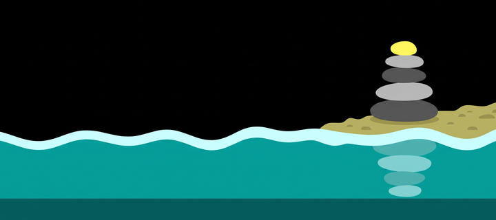

# Cairn

A guided breathing coach with live heart rate for the Pebble Time 2 (emery).

Breathe with the tide: **inhale and the water rises, exhale and it falls**,
uncovering a cairn of stones on the shore. Every finished session lays another
stone on your own cairn, and the watch scores how much calmer you got.



## Controls

| Button        | On the home screen           |
|---------------|------------------------------|
| SELECT        | start a session              |
| UP / DOWN     | change breathing pattern     |
| SELECT (hold) | progress & trends            |
| UP (hold)     | history                      |
| DOWN (hold)   | settings                     |

During a session: **SELECT** pauses, **BACK** asks to stop.

## What it does

- **Four breathing patterns** — Coherent (5.5 s in, 5.5 s out, about 5.5 breaths
  a minute), Box (4-4-4-4), 4-7-8, and a Custom rhythm you can set in
  half-second steps on the watch or from the phone.
- **Session lengths** of 1, 2, 3, 5, 10 or 15 minutes.
- **The tide is the guide:** the waterline rises through the inhale and falls
  through the exhale, with the phase name and a countdown above it. Optional
  haptic pulses on every phase change — a nudge to breathe in, a double tick to
  hold, a longer pull to breathe out — so the rhythm can be followed with your
  eyes closed. Sound, at four volume levels, marks the app opening and the end
  of a session; the breathing phases themselves are deliberately silent (see
  `src/c/sfx.c`: playing them from the phase machine's timer callback restarted
  PebbleOS on real hardware).
- **Live heart rate.** Cairn asks the sensor for a reading every second and
  waits on a short priming screen at the start, so the opening heart rate is a
  real baseline rather than a stale number.
- **A calm score, honestly named.** The watch only exposes BPM — never
  beat-to-beat intervals — so a clinical HRV/RMSSD reading is impossible. The
  score instead mixes how much of the session you completed (35%), how far your
  heart rate dropped (35%), and how strongly it swung with your breathing
  (30%, respiratory sinus arrhythmia). Without a sensor reading it falls back
  to completion alone.
- **A cairn that grows** with your daily streak, six badges to unlock, a
  personal best, and a history of the last 20 sessions.
- **Progress screen** with 7- and 30-day trends for calm score and resting
  heart rate, plus one coaching line drawn from that history.
- **Five languages** — English, Nederlands, Français, Deutsch, Español —
  following the watch's system language.

The phone is only used to store the trend history and to offer the same
settings in a Clay configuration page; the watch works on its own.

## Building

```bash
pebble build
pebble install --emulator emery      # or: pebble install --cloudpebble
```

A store-ready, size-optimized bundle:

```bash
python3 tools/release.py             # -> build/Cairn-release.pbw
```

## Tests

The pure logic (score, coaching rules, date maths, streaks, badges, the history
ring, and the phone-side trend maths) is tested off-watch:

```bash
tools/test/run.sh                    # C modules against a stub pebble.h
node tools/test/test_pkjs.js         # phone-side logic
```

## Art

`resources/images/` and `store/` are generated from the briefs in
`tools/CHATGPT_PROMPTS.md`: `tools/gen_icon.py` (menu icon),
`tools/gen_badges.py` (the six badge medals) and `tools/gen_store.py` (store
icons and banner). The raw generator output is not committed.

## Licence

MIT — see [LICENSE](LICENSE).
